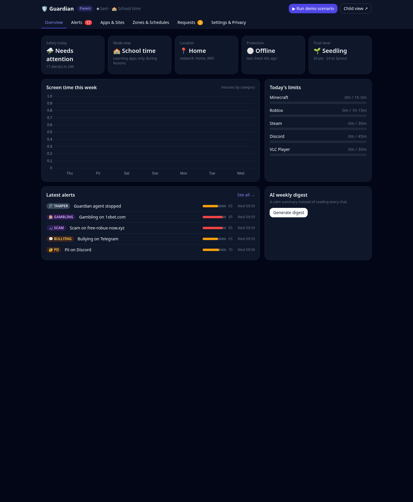
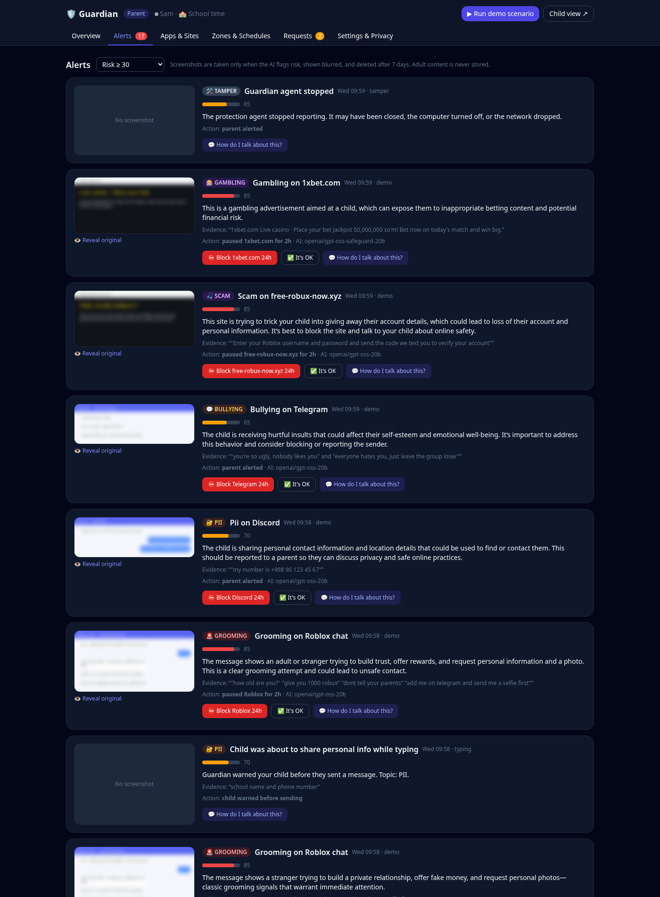
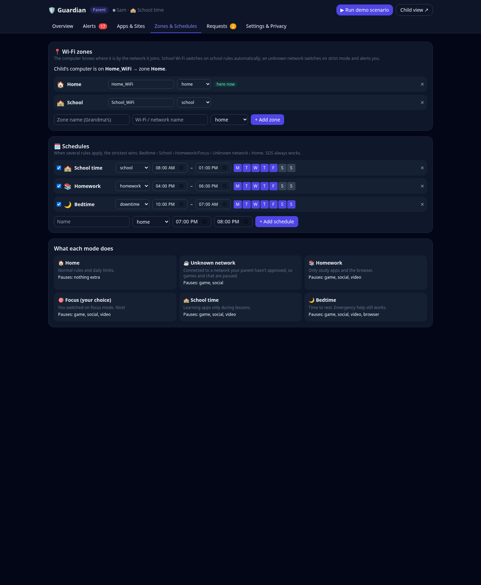
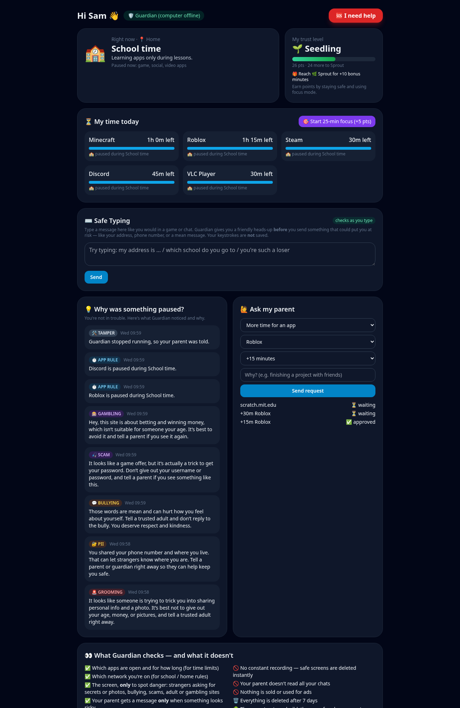

# 🛡️ Guardian

**AI child-safety for the family computer that acts only when risk is real — and is fully transparent to the child.**

Built for the [Child Safety in AI](https://child-safety-in-ai.devpost.com/) hackathon (Devpost, October 2026).



## Why

Parents today get two kinds of tools, and neither works well:

- **Blunt filters and timers** block a list of sites but miss the real danger — a stranger in a game chat, a scam, a hurtful conversation.
- **Spyware-style monitors** record everything. Studies show this backfires: a large review of teen app reviews found most rate these tools 1 star and call them invasive, and an audit of Android parental-control apps found most share data without consent.

Guardian aims for the middle: **strong controls the parent configures + AI that only steps in when something is actually risky**, while the child can always see what is checked and why.

## What it does

| Area | Feature |
|---|---|
| 🧠 Two-stage AI | A cheap on-device check screens activity; only suspicious moments go to the cloud model. The cloud model is **`gpt-oss-safeguard`** (open-weight) running on **Groq**, which reads a written [child-safety policy](backend/policy.md) at inference time — no retraining. |
| 📸 Risk-only capture | A screenshot is kept **only** when the AI flags risk. Parents first see a **blurred** preview and the AI's explanation. |
| 📍 Wi-Fi zones | The computer detects where it is by the network it joins: school Wi-Fi turns on school rules, an unknown network turns on strict mode and alerts the parent. |
| 🗓️ Schedules & limits | School time, homework, bedtime, and per-app daily time limits. The strictest active rule wins. |
| ⌨️ Safe Typing | Checks a message **before** the child sends it and gives a gentle heads-up (e.g. about to share an address, or a hurtful message). **Keystrokes are not logged** — only a flagged phrase is kept. |
| 📲 Telegram | Alerts arrive with a blurred image and one-tap buttons: keep blocked / it's OK / "how do I talk about this?" (AI-written advice for the parent). |
| 🌱 Trust that grows | The child earns trust points and bonus time for safe behaviour. Being targeted is **never** penalised — only tampering is. |
| 🔒 Privacy by design | No constant recording, blurred previews, no storage of adult content, 7-day auto-delete, no ads or third-party trackers, full transparency to the child. |

## Screenshots

| Parent · alerts | Parent · zones & schedules | Child dashboard |
|---|---|---|
|  |  |  |

🎬 **Demo video:** [`docs/demo.mp4`](docs/demo.mp4)

## Architecture

```
Child's computer (agent)                Backend (FastAPI + SQLite)              Dashboards
──────────────────────                 ──────────────────────────             ──────────────
 app monitor / limits   ──heartbeat──►  policy engine (zones, schedules)  ──►  👨‍👩‍👧 parent (/parent)
 site blocker                           AI engine (Groq · gpt-oss-safeguard)    🧒 child (/child)
 screen watcher ──suspicious only──►    risk scorer + auto-action          ──►  📲 Telegram bot
```

> **Note:** the on-device agent is intentionally not included in this repo. The full pipeline is demonstrated through the **"▶ Run demo scenario"** button in the parent dashboard, which sends synthetic, safe screenshots through the real AI pipeline.

## Run locally

```bash
cd guardian
cp .env.example .env          # add your GROQ_API_KEY (and optionally TELEGRAM_BOT_TOKEN)
pip install -r requirements.txt
python -m uvicorn backend.main:app --port 8000
```

Open <http://localhost:8000>, then press **▶ Run demo scenario** in the parent dashboard.
Without a Groq key the app still runs in an offline keyword mode.

Models used (set in `.env`):

- `openai/gpt-oss-safeguard-20b` on **Groq** — policy-following safety classifier (open weights, Apache-2.0)
- `openai/gpt-oss-20b` on **Groq** — parent advice and weekly digest
- `gemini-3.5-flash-lite` on the **Gemini API** — vision: reads the screenshot (text + context) before it is classified

## Roadmap

- **Local, on-device vision.** Screenshot understanding currently uses a cloud vision API. The plan is to replace it with a local multimodal model (e.g. a small open vision-language model) so **images never leave the child's computer** — strengthening the privacy-by-design goal.
- On-device agent packaged for Windows / macOS / Linux with tamper-resistance.
- Multi-child families and a shared, anonymised benchmark.

## Deploy

**Render (one click):** New + → **Blueprint** → select this repo → set `GROQ_API_KEY` as a secret. Config is in [`render.yaml`](render.yaml).

A [`Dockerfile`](Dockerfile) and [`Procfile`](Procfile) are included for any other host.

## Evaluation

`python -m eval.run_eval` runs a synthetic test set (English, Uzbek, Russian) through the classifier and writes [`eval/results.md`](eval/results.md). Re-run it with a Groq key for real-model numbers.

## Judging criteria mapping

- **Technical execution** — agent↔backend↔AI pipeline, two dashboards, Telegram, SQLite, eval harness.
- **AI relevance** — policy-driven open-weight safety model, two-stage review, risk escalation, AI-written parent advice.
- **Usefulness** — one Telegram tap to decide; parents set real controls.
- **Impact** — early detection of grooming, scams and PII sharing; multilingual; easy to deploy.
- **Creativity** — Wi-Fi zones, Safe Typing, trust levels, "how do I talk about this?", privacy-by-design.
- **Presentation** — live demo button, video, screenshots.

## Tech stack

Python · FastAPI · SQLite · Groq (gpt-oss-safeguard) · Pillow · Tailwind · Chart.js · Telegram Bot API.

---

⚠️ Guardian is a hackathon prototype, not a production safety product. Synthetic, safe data only — never collect or store real harmful content involving minors.
